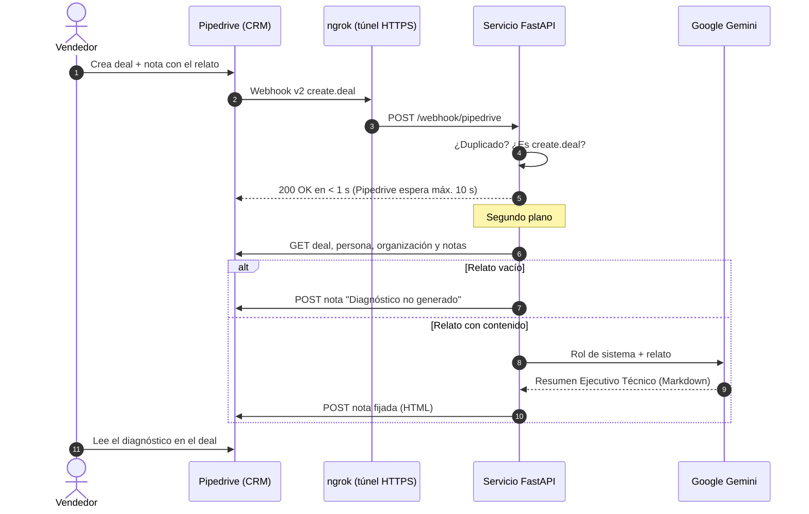
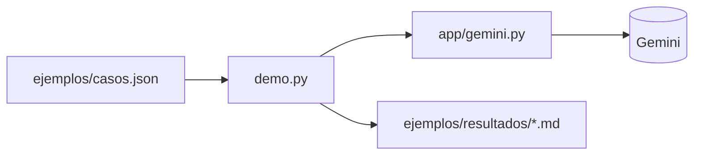

# 🤖 Diagnóstico IA de Pre-Ventas — Taranis Black

**Challenge ONE G11 · AI for Business · Ruta 1: IA para Ventas y Gestión Comercial**
Autor: Henry Taborda · Anexo técnico del informe ejecutivo

Cada vez que el equipo comercial crea un negocio (deal) en **Pipedrive**, este servicio lee el relato
del cliente, se lo entrega a **Google Gemini** con el rol de *Ingeniero de Pre-Ventas Senior* y
escribe de vuelta en el CRM un **Resumen Ejecutivo Técnico**: necesidad, urgencia, solución del
catálogo con valores, riesgos/objeción, información faltante y próximo paso.

Es la misma automatización que el curso *CRM, automatizaciones e IA* arma en Zapier, pero escrita en
Python: sin límites del plan gratuito, con control de errores y entendiendo cada pieza.

---

## 1. Problema

El equipo B2B de Taranis Black pierde **más del 40 % de su semana** llenando el CRM, redactando
correos genéricos y calificando prospectos con información insuficiente (Mock Kit, Ruta 1). Las notas
de los vendedores son informales ("Carlos otra vez pidiendo descuento…") y nadie las convierte en
algo accionable: los negocios se enfrían (en el kit, varios llevan **más de 30 días** sin contacto) y
las objeciones de precio y plazo se responden con argumentos débiles.

## 2. Solución

| Antes | Después |
|---|---|
| Nota informal del vendedor | Diagnóstico estructurado fijado en el deal |
| El gerente lee 20 notas para priorizar | Urgencia ALTA/MEDIA/BAJA justificada |
| Precios y políticas de memoria | Productos, cantidades y valor según el catálogo oficial |
| Objeción sin clasificar | Objeción tipificada (Precio, Presupuesto, Proveedor, Plazo, Personalización) |
| Negocios que se enfrían sin aviso | Alerta de "enfriamiento" si el último contacto supera 7 días |

**Supervisión humana (Human-in-the-Loop):** la IA *propone*; el vendedor valida antes de enviar
cualquier condición al cliente. El modelo tiene prohibido inventar precios o políticas que no estén
en el catálogo.

## 3. Arquitectura





### Componentes

| Archivo | Qué hace |
|---|---|
| `app/config.py` | Lee `.env`. Las claves nunca se imprimen. |
| `app/prompt_sistema.py` | Rol, misión, reglas de estilo, catálogo y formato de salida. |
| `app/gemini.py` | Llama a Gemini (SDK `google-genai`) con reintentos ante 429/5xx. |
| `app/pipedrive.py` | Lee el deal (API v2) y escribe la nota (API v1), con reintentos. |
| `app/main.py` | Servidor FastAPI: valida, evita duplicados, responde rápido, procesa en segundo plano. |
| `demo.py` | **Modo demo** sin Pipedrive: casos JSON → diagnósticos Markdown. |
| `probar_pipedrive.py` | Prueba manual contra tu cuenta (listar, leer, escribir nota). |
| `registrar_webhook.py` | Registra el webhook `create.deal` en Pipedrive por API. |
| `pruebas/pipedrive_simulado.py` | Pipedrive falso para probar el webhook sin cuenta. |

### Manejo de errores

| Situación | Respuesta del sistema |
|---|---|
| Deal sin descripción/notas | No llama a Gemini; deja nota "Diagnóstico no generado" pidiendo datos. |
| Gemini falla o responde vacío | Registra el error y libera el deal para reintentar. |
| Límite de solicitudes (429) | Reintenta con espera creciente (2, 4, 8 s); respeta `Retry-After` de Pipedrive. |
| Webhook duplicado / reintento de Pipedrive | Se ignora (registro persistente en `eventos_procesados.json`). |
| Deal que ya tiene diagnóstico | No se diagnostica dos veces. |
| Evento distinto a `create.deal` | Se ignora con 200. |
| JSON inválido / sin id | 400 / 422. |
| Webhook falso | Autenticación básica opcional (`WEBHOOK_USER` / `WEBHOOK_PASSWORD`). |

## 4. Cómo ejecutarlo (Windows · PowerShell)

```powershell
# 1. Entorno virtual e instalación
python -m venv .venv
.\.venv\Scripts\Activate.ps1
pip install -r requirements.txt

# 2. Credenciales
copy .env.example .env
notepad .env        # completa GEMINI_API_KEY, PIPEDRIVE_API_TOKEN, PIPEDRIVE_DOMAIN

# 3. Modo demo (solo necesita Gemini)
python demo.py
python demo.py 1043 1050     # solo algunos casos
```

### Con Pipedrive

```powershell
python probar_pipedrive.py              # lista tus deals (prueba la conexión)
python probar_pipedrive.py 12           # muestra lo que se enviaría a Gemini
python probar_pipedrive.py 12 --nota    # diagnostica y escribe la nota en el deal 12
```

### Webhook en vivo

```powershell
# Terminal 1: el servidor
uvicorn app.main:app --port 8000

# Terminal 2: el túnel público (instala con: winget install ngrok.ngrok)
ngrok config add-authtoken TU_TOKEN_DE_NGROK   # solo la primera vez
ngrok http 8000

# Terminal 3: registra la URL https://xxxx.ngrok-free.app que muestra ngrok
python registrar_webhook.py https://xxxx.ngrok-free.app
python registrar_webhook.py --listar
```

**Alternativa sin cuenta (la que se usó en la prueba en vivo):** Cloudflare Quick Tunnel.

```powershell
winget install Cloudflare.cloudflared
cloudflared tunnel --url http://127.0.0.1:8000     # muestra una URL https://xxxx.trycloudflare.com
python registrar_webhook.py https://xxxx.trycloudflare.com
```

También se puede registrar a mano: Pipedrive → *Herramientas y apps* → *Webhooks* → *Crear nuevo*:
evento **create.deal**, URL `https://xxxx.ngrok-free.app/webhook/pipedrive`.

> La URL gratuita de ngrok cambia cada vez que lo reinicias: registra el webhook de nuevo y borra el
> anterior. Si Pipedrive no logra entregar durante 3 días seguidos, elimina el webhook solo.

### Probar el webhook sin cuenta (Pipedrive simulado)

```powershell
$env:PIPEDRIVE_BASE_URL="http://127.0.0.1:9000"; $env:PIPEDRIVE_API_TOKEN="token-de-prueba"; $env:ESPERA_ANTES_DE_LEER="1"
uvicorn pruebas.pipedrive_simulado:app --port 9000    # en otra terminal
uvicorn app.main:app --port 8000
Invoke-RestMethod http://127.0.0.1:8000/webhook/pipedrive -Method Post -ContentType application/json `
  -Body '{"meta":{"action":"create","entity":"deal","entity_id":"101"}}'
Invoke-RestMethod http://127.0.0.1:9000/_notas/101
```

## 5. Ejemplo de entrada y salida

**Entrada** (nota informal del vendedor, caso #1043 del Mock Kit):

> Carlos de compras otra vez pidiendo descuento. Son 12 ErgoPro Core + 12 SmartDesk Studio, como
> 65.880. Dice que la silla de un catálogo de la competencia cuesta 800 dólares y que quiere 25% de
> descuento pagando de contado… Ojo: el problema real es que los operadores de rastreo 24/7 pasan
> 10 horas sentados, se cansan y se van (rotación alta). Pidió contrapropuesta el 16/10.

**Salida** (extracto; completo en [`ejemplos/resultados/1043.md`](ejemplos/resultados/1043.md)):

```markdown
## ⏱️ Urgencia / Prioridad
ALTA
* Riesgo crítico de enfriamiento: han transcurrido 32 días desde la solicitud del cliente (16/10/2026).
## 📦 Solución sugerida
* 12x ErgoPro Core (USD 1.890 c/u) = USD 22.680
* 12x SmartDesk Studio 140 (USD 3.600 c/u) = USD 43.200
## ➡️ Próximo paso recomendado
* Piloto sin compromiso de 2 puestos por 15 días en el centro de monitoreo…
```

Los 6 casos (5 objeciones distintas + 1 caso borde sin relato) están en [`ejemplos/`](ejemplos/).

### Prueba en vivo con Pipedrive real (17/11/2026)

`python pruebas/crear_deals_prueba.py 1043 1050 borde-sin-relato` creó 3 deals en una cuenta real.
Pipedrive envió 3 webhooks `create.deal` (200 OK) y en ~40 s aparecieron en el CRM:
2 diagnósticos fijados en *Focus* (LogiMax y Atlas) y 1 aviso «Diagnóstico no generado» (Hub Criativo).

## 6. Decisiones técnicas (verificadas en la documentación oficial)

- **Modelo:** el curso usa `gemini-2.5-flash`, pero Google lo marcó como obsoleto (se redirige desde
  el 01/12/2026). Por eso el modelo es configurable (`GEMINI_MODEL`) y por defecto `gemini-3.6-flash`.
- **Evento:** en webhooks **v2** (versión por defecto) el evento de un negocio nuevo es
  **`create.deal`**; `added.deal` era el nombre en v1. El servicio acepta ambos.
- **Respuesta en segundo plano:** Pipedrive considera fallido un webhook que tarda más de 10 s y
  reintenta a los 3, 30 y 150 s. Gemini tarda ~15–20 s, así que se responde 200 de inmediato.
- **Autenticación:** token en el header `x-api-token` (no en la URL, para que no quede en logs).
- **Fechas:** el prompt recibe la fecha de hoy. Sin eso, Gemini leía "pidió contrapropuesta el
  16/10" como un plazo futuro (error detectado en la primera prueba y corregido).

## 7. Qué haría diferente con más tiempo

1. **Desplegarlo 24/7** (Cloud Run o un servidor pequeño) en vez de ngrok, con URL fija.
2. **Cola de trabajos** (Redis/Cloud Tasks) en lugar de tareas en segundo plano del proceso.
3. **Salida JSON estructurada** (`response_schema`) para llenar campos del CRM: prioridad, objeción
   y valor como campos filtrables, no solo texto.
4. **Firma del webhook / lista de IPs** de Pipedrive además de la autenticación básica.
5. **Evaluación**: 20 prospectos del kit con la respuesta esperada para medir precisión al cambiar
   prompt o modelo.
6. **Anonimizar datos personales** (correo, nombre) antes de enviarlos al modelo, según la política
   de IA de la Ruta 0.
